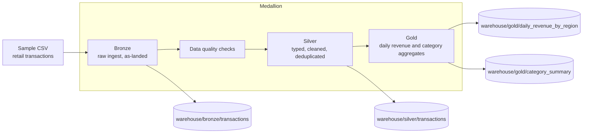

# databricks-medallion-lakehouse

A compact Bronze / Silver / Gold pipeline that shows a Medallion-style lakehouse layout on local files. The same transforms run on **pandas** by default, and on **PySpark** when it is installed. Output is written as Parquet in a Delta-style directory tree (`warehouse/{bronze,silver,gold}/...`).

This is a reference implementation for local study and interviews. It is not a Databricks workspace job and does not require a cluster.

## Architecture



### Layer contracts

| Layer | What is stored | Rules |
| --- | --- | --- |
| **Bronze** | Raw rows plus `_ingested_at` and `_source_file` | No business filters. Types stay close to the file. |
| **Silver** | Conformed transactions | Drop rows missing `transaction_id` or `event_ts`; parse timestamps; keep `quantity > 0` and `unit_price > 0`; allow only known `status` values; deduplicate by `transaction_id` (latest event wins); compute `amount`. |
| **Gold** | Business aggregates | Completed orders only: daily revenue by region, and category totals. |

Quality checks run after Silver is built. Failed checks raise an error and the Gold layer is not written.

## Quick start

```bash
python -m venv .venv
source .venv/bin/activate
pip install -r requirements.txt

# pandas engine (default)
python -m lakehouse --source data/sample_transactions.csv --warehouse ./warehouse

# optional Spark engine
pip install -r requirements-spark.txt
python -m lakehouse --source data/sample_transactions.csv --warehouse ./warehouse --engine spark
```

The sample file includes duplicates, missing identifiers, a negative quantity, and an unknown status so the quality rules have something to reject.

## Tests

```bash
pytest -q
```

Pandas-backed tests always run. If `pyspark` is importable, a second set of tests exercises the Spark engine; otherwise those tests are skipped.

## Project layout

```
data/sample_transactions.csv
src/lakehouse/          pipeline, quality, engines
tests/
warehouse/              created at runtime, not committed
```

## License

MIT © 2026 Rajesh Kumar Rajput
